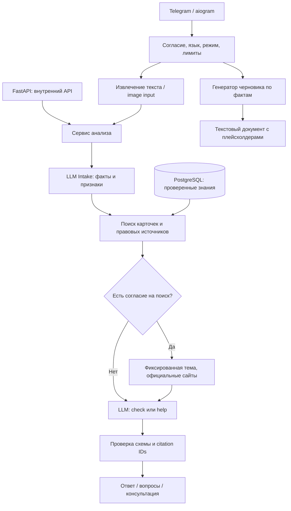

# Архитектура

Это исходное проектирование версии 0.1. Реализованные изменения версии 0.2 (очередь, persistent sessions,
hybrid search, verifier, анкеты и экспорт) описаны в [RELEASE_02.md](RELEASE_02.md).

## Основное решение

Начать с модульного монолита с общим сервисным слоем. Telegram и FastAPI — разные адаптеры,
доменная логика не зависит от Telegram. Модель не получает SQL, токены, доступ к файловой системе или банковским операциям.
PostgreSQL хранит знания. Персональные обращения не становятся учебной базой автоматически.

## Границы модулей

| Модуль | Ответственность | Не должен делать |
|---|---|---|
| `bot.py` | Согласие, команды, загрузка, вывод, сессия | Утверждать нормы из собственных шаблонов |
| `main.py` | Внутренний API, авторизация, таймаут | Публичная идентификация граждан |
| `files.py` | Ограниченное извлечение | Запуск макросов, открытие вложенных URL |
| `llm.py` | Intake → RAG → web → answer | Самостоятельно выполнять действия в банке/органах |
| `retrieval.py` | Только опубликованные/актуальные записи | Возвращать draft как проверенную правовую базу |
| `privacy.py` | TTL, HMAC-ключ, частичное маскирование | Обещать полное обезличивание regex-ами |
| `render.py` | Вывод ссылок и ограничений | Исполнять HTML/Markdown от модели |

## Сценарий «Проверь»

1. Человек выбирает язык и разрешает обработку. Режим не ограничивает распознавание уже наступившего ущерба.
2. Файл проверяется по размеру и типу, извлекается текст или подготовленное изображение.
3. Intake выделяет ситуацию, признаки, краткие факты без идентификаторов, тему поиска.
4. PostgreSQL находит опубликованные схемы и правовые фрагменты с действующей датой проверки.
5. При согласии выполняется поиск общей темы. В поиск никогда не передаётся полная история случая.
6. Ответ: риск / признаки / возможный механизм / безопасная проверка / до трёх вопросов / источники.

`unknown` — полноценный исход. «Не нашли схему» не означает «схема безопасна». Риск не является обвинением
или вероятностью совершения преступления. Критические признаки задают нижнюю границу риска.

## Сценарий «Уже случилось»

Немедленная памятка показывается при выборе режима, до LLM. Затем используются ветки money, loan,
credentials, blocked, dropper; дополнительные обстоятельства отражаются в фактах.
Вопросы задаются короткими порциями. Человек может сразу получить общие действия, даже если часть фактов неизвестна.
В текущем каркасе история — ограниченный набор текстовых фактов/вопросов в памяти. Для production заменить
его типизированным `CaseState`: события, источник каждого факта, неизвестные поля, подтверждённые пользователем сведения.
Извлечённое OCR-значение даты, суммы или реквизита считается неподтверждённым до подтверждения пользователем.

Для антифрода первым вопросом выяснять, кто ввёл ограничение и какое уведомление есть. Один универсальный
«план разблокировки» недопустим: банковская проверка, антифрод-сигнал и процессуальное решение различаются.
При подозрении на участие в дропперстве — законное прекращение новых операций, сохранение доказательств и юрист.

## Обработка файлов

MVP: данные только в памяти, subprocess имеет 20-секундный таймаут, Office ZIP имеет лимит развёрнутого размера,
макросы/зашифрованные пакеты отвергаются. Картинки декодируются и пересохраняются без исходных метаданных.
Subprocess не является полной защитной песочницей: он наследует окружение и права процесса.

Production-конвейер: загрузка в карантин → реальный MIME/magic → антивирус → parser container без сети,
без ключей, non-root, read-only root, tmpfs, лимиты CPU/RAM/PIDs → текст с координатами/страницами → PII preview.
Файл с угрозой, паролем или неподдерживаемым типом получает понятный отказ, а не низкий риск.
Конвертеры LibreOffice/Tika подключать только в этой песочнице. PDF-сканы: OCR ru+kk с confidence и страницами.
ASR для аудио и видео — отдельные адаптеры и отдельное согласие. Не скачивать пользовательские URL напрямую.
Будущий URL-scanner должен защищаться от SSRF, редиректов, DNS rebinding, private IP и скачивания огромных файлов.

## RAG production

Две коллекции: `scheme_cards` для аналогий и `legal_sources/legal_chunks` для юридических оснований.
Hybrid retrieval: FTS + multilingual embeddings (RU/KK/mixed) → reciprocal rank fusion → reranker →
фильтр KZ/даты/статуса → не более 6–10 релевантных фрагментов. Модель не загружает весь закон в каждый запрос.
Размерность pgvector и модель эмбеддингов версионировать. Смену модели выполнять переиндексацией новой коллекции.
Ответ должен ссылаться на конкретный фрагмент, норму и редакцию, а не просто на главную страницу сайта.

Веб-поиск — fallback и источник кандидатов на обновление базы. Материал из поиска не публикуется автоматически.
Новости и предупреждения банков помогают распознать схему; юридическая сила из них не выводится.
При недоступности поиска бот использует проверенную базу или честно ограничивается общими защитными действиями.
В MVP web-справка атрибутируется по tool citations, но её смысловая достоверность требует контроля.

## Документы

Семь видов: полиция, спорная операция, спорный кредит, АРРФР, основания блокировки, временные меры по кредиту,
памятка о доказательствах. MVP выдаёт редактируемый текст. ФИО/ИИН/адрес можно вписать локально после генерации.
Неизвестные поля — плейсхолдеры. Не добавлять несуществующие приложения. Не отправлять документ автоматически.
Production: подтверждённые слоты → утверждённый юристом RU/KK-шаблон → DOCX/PDF → preview → скачивание.
PDF должен встраивать шрифт с Ә Ғ Қ Ң Ө Ұ Ү Һ І; проверять переносы, подписи и отсутствие обрезанных полей.

## Приватность и безопасность

База знаний не содержит пользователей. Сессионный идентификатор — HMAC от Telegram ID, но это псевдонимизация,
не юридически гарантированная анонимизация. Удаление памяти не стирает Telegram, резервные копии внешних систем
или provider retention. `store=False` отключает сохранение Responses для последующего получения; условия
хранения внешнего провайдера проверяются отдельно. Regex не находит все ФИО, адреса и текст на картинках.

До публичного запуска определить законное основание обработки, текст согласия, размещение инфраструктуры,
трансграничную передачу и сроки удаления с юристом по праву РК. Не обещать пользователю хранение только в РК,
если изображения и текст уходят зарубежному провайдеру. Альтернатива — локальные OCR/PII/model endpoints.

Администратор знаний: отдельная роль и журнал публикаций без материалов обращений. Секреты — secret manager.
Логи: request_id, длительность, этап, код ошибки, модель/версия промпта, количество токенов; без текста/файлов/токенов.
Метрики: timeout, отказ парсера, отсутствие источника, cost/session, retrieval hit-rate, ложный low-risk.
Логи ошибок интеграций обязательно очищать: Telegram download URL содержит токен.

## Надёжность и масштабирование

MVP — один polling-процесс, максимум четыре активных pipeline, лимит частоты на сессию. Нет долговечной очереди,
распределённых лимитов, exactly-once и восстановления после падения. При рестарте незавершённый запрос может потеряться.
`/delete` при активном запросе просит дождаться окончания; production должен поддерживать отмену и revocation token.

Production — webhook с secret token, bounded durable queue, dedup по update_id, worker leases, retry с backoff,
статусы queued/running/completed/failed/cancelled, outbox доставки. Дедупликация метаданных не требует хранения тела
после TTL. Redis можно добавить для очереди/сессий; PostgreSQL остаётся источником знаний.
Данные сессии в persistent storage шифровать отдельным короткоживущим ключом, удалить также ключ/бэкапы по политике.
Идемпотентность отправки в Telegram имеет ограничения: предусмотреть редкие дубли при сетевой неопределённости.

Задать бюджет запросов и расходов на пользователя/день, admission control до загрузки файла, общий потолок
заданий, circuit breaker провайдеров. HTTP retry не должен повторно отправлять заявления или совершать действия.
LLM не должен иметь таких инструментов вообще. На перегрузку отвечать очередью/понятным отказом без ложного анализа.
